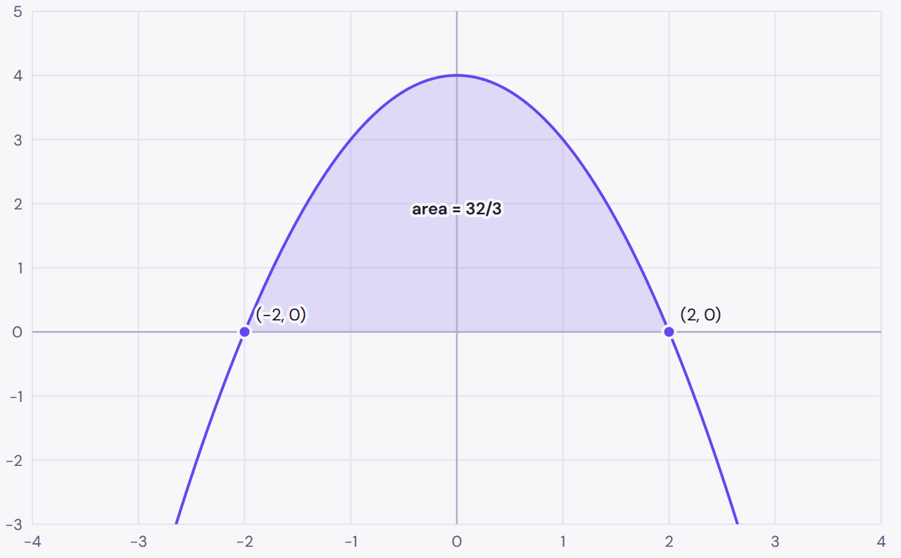
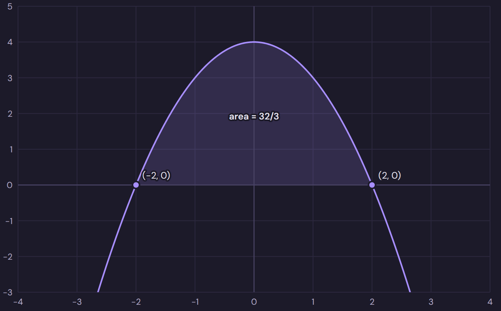
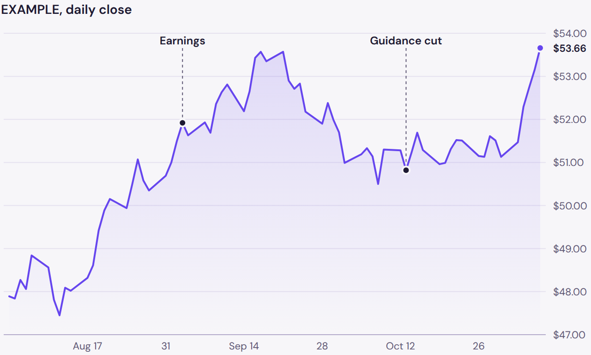
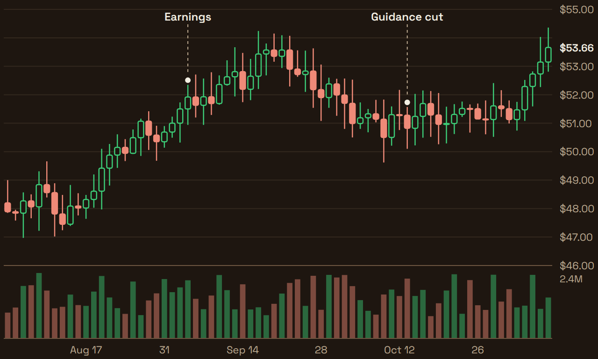
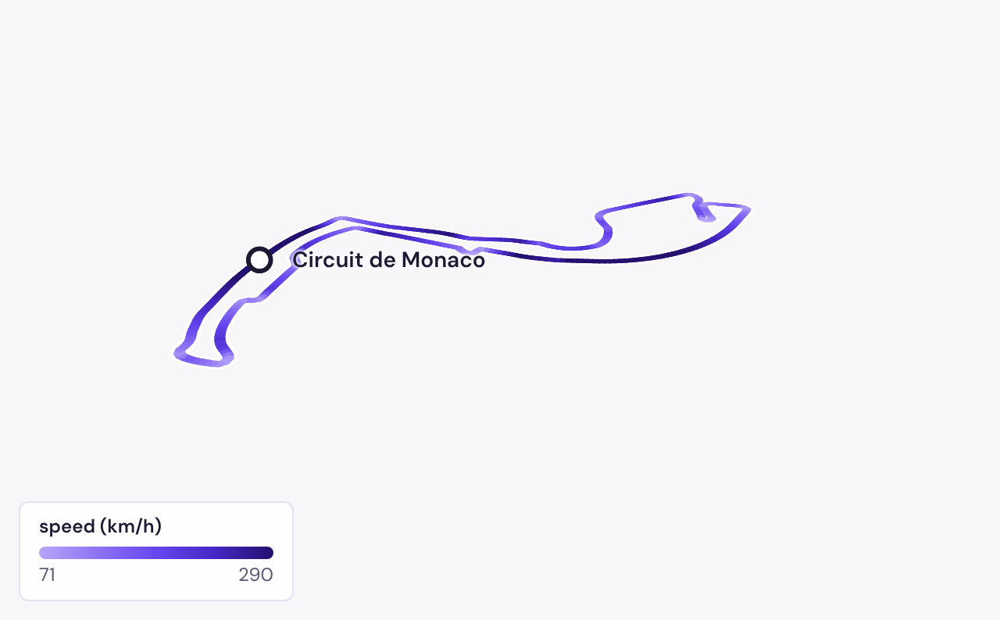
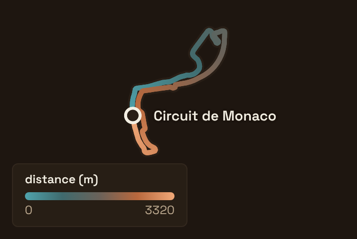
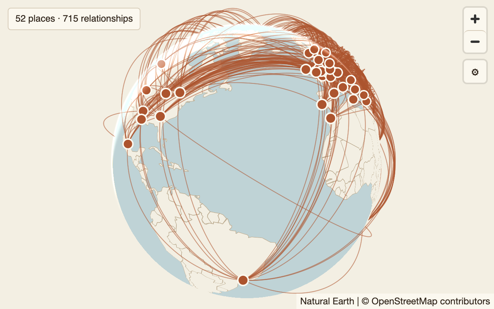

# zega graph components

The single definition of every graph component (APS 21: surface × mark ×
encoding, typed contracts, chosen by the agent), and **the web package that
draws them**, `@zegadb/components`. Ava's chat and ava's maps import it;
zega.dev's catalogue reads its contracts.

| platform | status | stack |
|---|---|---|
| web | **built** (this package) | SVG for charts, MapLibre GL JS for maps; React or plain DOM hosts |
| desktop (Tauri) | built | the same web build in the webview (Ava's app) |
| iOS | **paused** (Sami, 15 Nov) | `generated/Tokens.swift` and `tokens.rs` stay as they were and are not extended; no iOS specs are written |

## The rule

**The spec is the product.** A component is what its spec, contract, tokens
and fixtures here say it is. An implementation is **conforming** only if it
renders every one of that component's fixtures, in both themes, within
tolerance of the reference images ([CONFORMANCE.md](CONFORMANCE.md)).

- **Contracts are plain typed data** (Sami, 15 Nov). A view spec is
  `{ component, data, options }`: the data inline, held to the contract's
  `data` JSON Schema; the options to its `options`. Data comes from anywhere:
  the assistant's tools, the knowledge graph, the model itself, or a ZQL
  result through a contract's optional `zql` adapter (format 1's binding,
  kept for zega's explorer). ZQL is one source, never the shape.
- **Validate, then draw.** Every host runs the package's `validate()` before
  anything renders. A spec that fails draws nothing; its errors (teaching
  errors: where, what, what to do) go back to whoever wrote it. People never
  see raw errors.
- **Colour follows each product's brand** (Sami, 15 Nov):
  [tokens/themes.json](tokens/themes.json) has one theme per host (`ava`:
  the Lilac/Night violet, DM Sans; `zega`: the paper ground, zega green,
  Space Grotesk), light and dark, the same roles everywhere. Categorical
  orders were checked with a palette validator (lightness band, chroma,
  colour-blind separation) against each ground.
- **Values come from tokens**; specs name `{theme.<role>}` and
  `{group.name}` tokens, never raw hex or px.
- **Known gaps are named** in each spec's Conformance section.

## Components

| component | category | status | web reference (light, dark) |
|---|---|---|---|
| [function-plot](components/function-plot/function-plot.spec.md): y = f(x), areas, points, asymptotes | Math | review |   |
| [price-chart](components/price-chart/price-chart.spec.md): line or candlesticks, volume, annotations | Finance | review |   |
| [path-on-map](components/path-on-map/path-on-map.spec.md): ordered paths on the map, tilted with 3D buildings by default, a "2D \| 3D" switch in the map's controls | Geo | review |   |
| [body](components/body/body.spec.md): a 3D human body (man, woman, boy and girl of 8), organs, skeleton, muscles and nerves lit, still or orbit and fly-to (three.js; body meshes CC BY 4.0, [assets/body/LICENSE](assets/body/LICENSE); muscles and nerves from Z-Anatomy, **share-alike**, only in [packages/body-za](packages/body-za/NOTICE); children from [paediatric references](components/body/references.json)) | Anatomy | draft (zegadb/components#5, phases 1–3) | none yet: proposals await Sami |
| [globe-arcs](components/globe-arcs/globe-arcs.spec.md): routes as arcs on the globe | Network | review (format 1, zega's explorer) |  |
| [hockey3darena](components/hockey3darena/hockey3darena.spec.md): rink heat | Sports | draft (format 1) | none yet |

## Using the package

```ts
import { validate, explain, render, theme, toElements, attachHover, toolDefinitions } from "@zegadb/components";

const checked = validate(spec);                       // anything: a model's JSON
if (!checked.ok) return explain(checked.errors);       // to the model, never to people
const drawn = render(checked.view, { width, theme: theme("ava", "dark") });
// charts: drawn.svg is a tree of SVG elements → toElements(drawn.svg, React.createElement) or toDom()
// then attachHover(svgElement, drawn.hover, theme) for the crosshair and tooltip
// path-on-map: drawn is { map: true, height }; the host's MapLibre map + drawChecked() from
// "@zegadb/components/path-on-map/draw" (pathOnMap.plainStyle(theme) when there is no basemap);
// on a map the reader can move it adds the 2D | 3D switch top-right (controls: false to place
// viewToggle() among the host's own controls, setMapView() to switch)
// the host's basemap: basemapStyle("ava", mode, lang) from "@zegadb/components/basemap"
// (needs @protomaps/basemaps); AVA_BASEMAP (main entry, no map code) is its origin, credit, palette
```

**Entry points.** Each is a `package.json` export; a host bundles only what it imports.

| entry | what |
|---|---|
| `@zegadb/components` | `validate`, `render`, `toolDefinitions`, themes, SVG helpers, `pathOnMap`; function-plot, path-on-map and price-chart. No body, no map or three.js code |
| `@zegadb/components/body` | the same `validate`, `render`, `toolDefinitions`, `COMPONENT_IDS`, `CONTRACTS` with the body added; `BODY_REGIONS`, `bodyRegionName`, the `body` model, `BODY` |
| `@zegadb/components/body/draw` | `drawBody()` (three.js) |
| `@zegadb/components/path-on-map/draw` | `drawChecked()`, `drawPaths()`, `checkPaths()`, the 2D \| 3D switch `viewToggle()` and `setMapView()` (MapLibre); checks paths against path-on-map's contract alone, so no other component's code |
| `@zegadb/components/basemap` | `basemapStyle()` (@protomaps/basemaps) |

The body's contract, region table and mesh manifest are large, so they are
only in its entry. A host that draws a body imports `validate` and `render`
from `@zegadb/components/body` instead of the main entry (everything else
checks and draws the same), or registers it with its own list:
`registry([BODY, ...BUILT_IN])` (`registry`, `BUILT_IN` from the main
entry, `BODY` from the body's). `src/entries.test.ts` bundles the other
entries and fails if any of the body's strings are in them, and fails if
the path-on-map draw entry carries function-plot's or price-chart's
contract or code, or the assistant's tools.

- **Basemaps:** a host's street map is defined once here
  (`src/basemaps.ts`; the style in `src/basemap.ts`), so every surface of the host shows the same map. Ava's
  is tiles.addis.gg (Protomaps v4, the world archive, no key) in the "Quiet"
  palette; ava's maps and Ava's chat both draw on it. The style carries no
  attribution control: the host says the credit once, in its own type, and
  never with an "edit the map" link. If the tiles can't be read, the host
  falls back to `pathOnMap.plainStyle` and the paths are drawn the same.

- **Never markup.** Charts are SVG node trees a host turns into its own
  elements; model-written text is always text. Expressions (function-plot)
  are parsed by `src/expr.ts`, never `eval` or `Function`.
- **Tools for an assistant:** `toolDefinitions()` gives one tool per
  component (`draw_function_plot`, …) whose input schema is the contract's
  own `{ data, options }`; the host adds the component from the tool's name.
- **Sizing:** inline in a column (rixse APS 4's medium size), the width is the
  column's and the height is width × the contract's `size.aspect`, within its
  `minHeight`–`maxHeight`. Fixtures render at 640 pt (a desktop chat column)
  and 358 pt (a 390 pt phone's column).
- **Styles:** `@zegadb/components/themes.css` (`--zc-*` variables under
  `[data-zc-host]`) and `@zegadb/components/components.css` (the map legend
  and labels).

**Packaging (APS 10):** hosts install the package from a registry by version.
Until it is on npm they vendor the exact `npm pack` tarball
(`node tools/pack.mjs <dir>` prints its sha256, integrity and commit; packing
is reproducible) and depend on it with `file:` plus a drift test. **Needs
Sami: npm publishing for @zegadb/components (release env).**

## Illustrated surfaces (anatomy, sports): how they fit

A contract's `surface` is `{ kind, art?, frame?, regions? }`. A body diagram
or a rink is `kind: "art"`: `art` names the drawing (an SVG the package ships
per surface, themed from the same roles), `frame` its coordinate system
(`{ x: [-100, 100], y: [-42.5, 42.5], unit: "ft" }` for a rink), and
`regions` the named areas data may refer to (`left-knee`, `slot`). The data
schema then uses plain numbers in the frame (`{ x, y, value }`) or an `enum`
of the regions (`{ region: "left-knee", value }`). Nothing in the contract
format, the validator, the view spec or the chat changes: a new surface is a
new contract, a new drawing and its fixtures.

## Layout

```
components/<id>/
  <id>.spec.md, <id>.contract.json      the spec (TEMPLATE.spec.md's sections) and the contract
  web/<name>.json, web/data/*.json      web fixtures (format 2: plain data, a host theme, a width)
  web/<name>.reference(.dark).png       their renders by the web package
  fixtures/…                            format-1 fixtures (a ZQL result), rendered by zega's explorer
src/                                    the web package (TypeScript; src/generated/ from contracts + themes)
tokens/tokens.json, tokens/themes.json  design tokens; host themes
generated/                              tokens.css/js (+ paused Tokens.swift, tokens.rs), themes.css
schemas/                                contract (2) and v1, view spec (2) and v1, fixtures, tokens, themes
tools/                                  checks, generators, renderers, the comparator, pack
```

## Working here

Node 24 or newer.

```sh
npm install
npm run generate        # tokens + src/generated (contracts, themes) + generated/themes.css
npm run check           # every repository rule; CI runs it
npm test                # unit tests (validator, parser, renderers) and the checks' own drift tests
npm run typecheck && npm run build
node tools/render/container.mjs tools/render/web.mjs            # (re)render web references in the pinned image
node tools/render/container.mjs tools/render/web.mjs --verify   # web conformance, as CI runs it
npm run verify:zega -- --zega ../zega                           # zega's explorer against format-1 references
```

**Adding a component:** copy `TEMPLATE.spec.md` to
`components/<id>/<id>.spec.md` with `status: draft`, write the format-2
contract, then the renderer in `src/`, web fixtures and references.

## Open questions for Sami

1. **zega's ramps.** The zega theme's sequential ramp is a new green one (to
   match zega.dev's accent); the diverging ramp is the explorer's. Proposal
   until approved.
2. **Ava's app vs Ava's brand.** Charts in Ava's app use the brand book's
   violet; the app's own chrome is still the older warm orange. Recommend the
   app moves to the brand palette.
3. **Contract ownership** (format-1 question 4) stands: this repo owns the
   contracts; zega's explorer should vendor them with a drift check.
4. **Naming:** rename `hockey3darena` to `rink-heat` when it becomes format 2.
