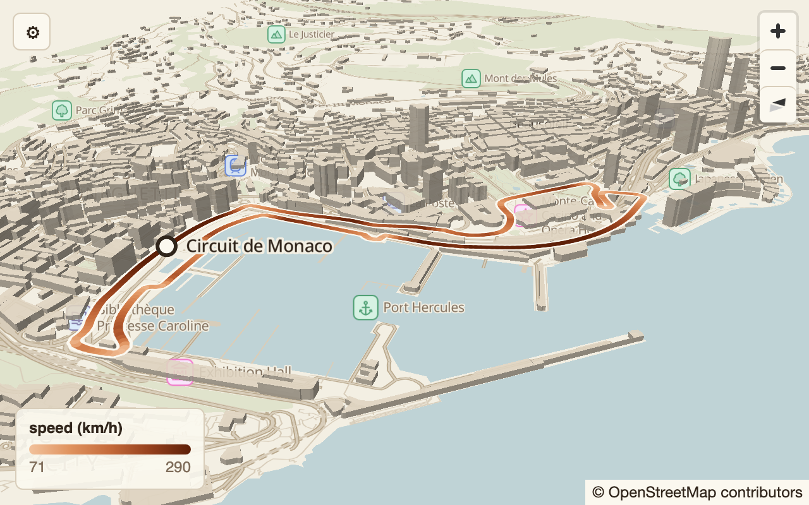
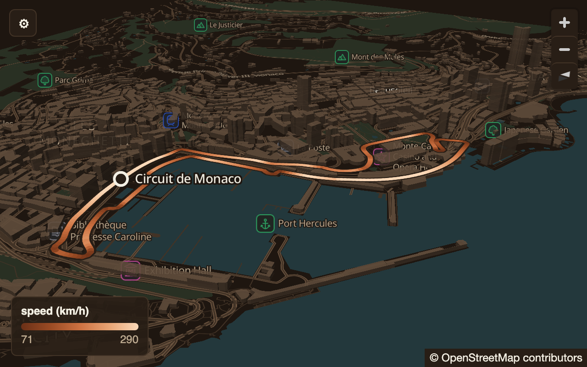
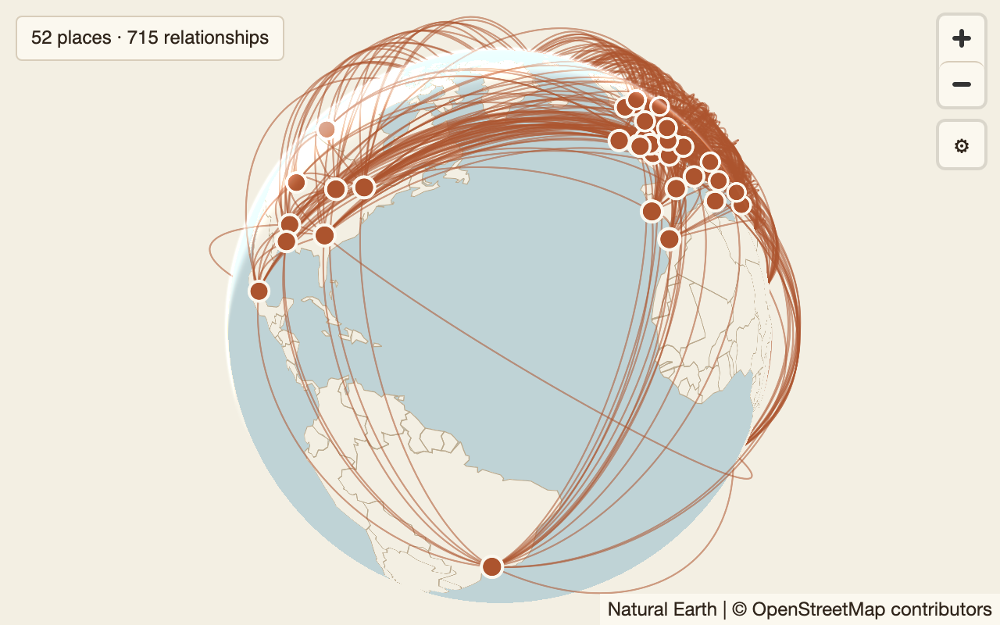
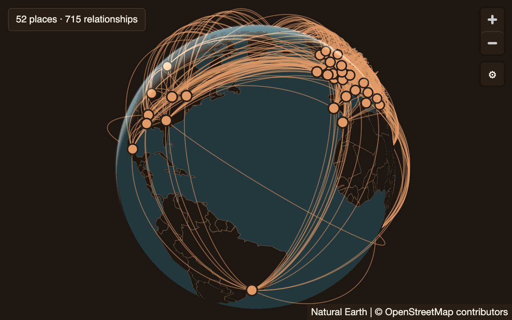

# zega graph components: specs

The single definition of every zega graph component (APS 21), for every
platform that draws one:

| platform | stack | map surface |
|---|---|---|
| web | Next.js | MapLibre GL JS |
| desktop | Tauri (Rust + the same Next.js build) | MapLibre GL JS in the webview |
| iOS | Swift / SwiftUI | native map SDK (open question 2) |

## The rule

**The spec is the product.** A component is what its spec, contract, tokens
and fixtures here say it is. An implementation on any platform is
**conforming** only if it renders every one of that component's fixtures, in
both themes, within tolerance of the reference images
([CONFORMANCE.md](CONFORMANCE.md)). Nothing else makes it done.

- **No platform-specific design decisions.** A platform chooses *how* to draw
  (which API, which layer type), never *what*: no different size, colour,
  spacing, timing, gesture, wording or behaviour.
- **Deviations need a spec change first.** If a platform cannot do what the
  spec says, open a PR here that changes the spec (and its fixtures and
  references); once Sami approves it, every platform follows. Never ship the
  deviation and document it afterwards.
- **Values come from tokens.** Colours, type, spacing, radii, strokes,
  opacity and motion come from [tokens/tokens.json](tokens/tokens.json)
  through the generated files, never typed in by hand on a platform.
- **Contracts are typed.** What a component accepts (roles, types, units,
  frames, parameters, ranges, defaults) is its `.contract.json`; an
  implementation validates view specs against it and draws nothing it
  refuses.
- **Known gaps are named.** Where today's reference implementation falls
  short of its spec, the spec's Conformance section says so; other platforms
  build the spec, not the gap.

## Layout

```
components/<id>/
  <id>.spec.md                  the spec: TEMPLATE.spec.md's sections, in order
  <id>.contract.json            the typed contract (schemas/contract.schema.json)
  <id>.reference.png            render of fixtures/default.json, light
  <id>.reference.dark.png       the same, dark
  fixtures/<name>.json          one input: view spec + result file + size (schemas/fixture.schema.json)
  fixtures/<name>.reference.png, <name>.reference.dark.png   its renders (all but default)
  fixtures/data/*.json          result snapshots the fixtures bind
tokens/tokens.json              design tokens: the only source of visual values
generated/                      tokens.css, tokens.js, Tokens.swift, tokens.rs (never edited by hand)
schemas/                        contract + view-spec (from zegadb/zega), fixture, tokens
tools/                          token generator, repo checks, web reference renderer + comparator
REFERENCES.lock.json            what rendered the references, and each image's SHA-256
```

**Names.** Every file in a component's folder is named with the component's
contract `id`, exactly: `path-on-map/path-on-map.spec.md`, like Sami's
`hockey3darena.spec.md` + `hockey3darena.reference.png`. One name everywhere
(folder, files, contract, view specs, code) means no mapping table and a grep
finds everything. Ids are lower case letters and digits with optional hyphens
(`^[a-z][a-z0-9]*(-[a-z0-9]+)*$`, the view-spec schema's own pattern), so the
shipped `path-on-map` and a flat `hockey3darena` both fit; see open
question 5.

**Status.** Each spec's front matter has `status`:

- `draft`: being written. Needs a spec and a contract; no references; no
  platform implements it.
- `review`: complete. Every section filled, at least a default fixture, light
  and dark references for every fixture. Platforms build to it.
- `stable`: Sami has accepted it on every platform. Changes need a version
  bump in the contract.

**Units.** Lengths are points: 1 pt = 1 CSS px = 1 iOS point. Specs never
write px. References are rendered at scale 2.

## Components

| component | status | reference (light, dark) |
|---|---|---|
| [path-on-map](components/path-on-map/path-on-map.spec.md): ordered paths on the street map with 3D buildings | review |   |
| [globe-arcs](components/globe-arcs/globe-arcs.spec.md): routes as arcs lifted off the globe | review |   |
| [hockey3darena](components/hockey3darena/hockey3darena.spec.md): rink heat, 2D or 3D | draft | none yet |

## Working here

Node 22 or newer; no dependencies.

```sh
npm run tokens          # tokens/tokens.json -> generated/*
npm run check           # every rule below; CI runs it
npm test                # proves each check fails on the drift it exists to catch
npm run render -- --zega ../zega            # re-render references from a zegadb/zega checkout
npm run verify:web -- --zega ../zega        # web conformance: render and compare, write nothing
```

`npm run check` enforces: tokens.json against its schema and generated files
current; each contract against the contract schema, its example specs against
the view-spec schema and the contract, and its invalid example's error exact;
each fixture against the fixture schema and its contract, with its result
file present; a spec, contract, default fixture and light and dark references
for every non-draft component, at the fixture's pixel size and matching
REFERENCES.lock.json; every spec with the template's sections in order, no raw
hex colour or px length outside its `## Tokens` section, every `{token}`
reference real, and every relative link resolving.

**Adding a component:** copy `TEMPLATE.spec.md` to
`components/<id>/<id>.spec.md` with `status: draft`, write the contract, and
open a PR. To move it to `review`: fixtures, a web implementation, rendered
references, every section filled.

**Where things come from.** The contract and view-spec schemas and the JSON
Schema interpreter (`tools/lib/schema.js`) are copied from zegadb/zega
`browser/components/` at 11cff10, so a contract here is checked by the same
code the runtime uses. Token values are the web implementation's
(`browser/theme.js`, `components/canvas.css`, `path-on-map/index.js`,
`arcs.js`, `globe.js`); `generated/tokens.js` matches `theme.js`'s palettes
exactly.

## Open questions for Sami

1. **Which accent do graph components use?** The component tokens are the
   explorer's palette: the same paper ground as zega.dev, but a terracotta
   accent (`{color.accent}`), while zega.dev and zega.earth use green.
   *Recommendation:* keep terracotta for data marks (it is what every
   rendered component and the explorer already show, and at 4.49:1 on the
   ground it clears the 3:1 that marks need) and add the site's green as a
   separate brand token for chrome such as share-card wordmarks, so marks and
   brand never compete.
2. **Mapbox or MapLibre Native on iOS?** Identical maps need the same style
   JSON, the same PMTiles archives, the same glyphs and a custom-layer API for
   the arcs. MapLibre Native reads the style MapLibre GL JS reads; the Mapbox
   SDK requires its own logo and attribution, has its own style-spec
   extensions, and would need our tiles served its way. *Recommendation:*
   MapLibre Native on iOS; keep Mapbox only for a product reason (its data or
   search), and accept a wider mask and tolerance if so.
3. **One bundled UI face.** Chrome text (legend, gear, badges) uses the
   system face, so it differs between macOS, Windows, Linux and iOS, and the
   references can only be rendered on a Mac. *Recommendation:* bundle one
   face on every platform (Space Grotesk, already the wordmark face, or IBM
   Plex Sans for small sizes), set `{type.family.ui}` to it, and re-render
   the references once.
4. **Which repo owns the contracts?** Today `path-on-map`'s contract lives in
   zegadb/zega and is copied here. *Recommendation:* this repo owns
   contracts, tokens and fixtures; zegadb/zega vendors them at a pinned
   commit (as it vendors the wasm), and its CI fails when its copy differs.
5. **Naming.** Shipped ids are hyphenated (`path-on-map`; renaming is a
   breaking contract major with a migration), your example is flat
   (`hockey3darena`). *Recommendation:* one rule, file name = contract id,
   hyphens allowed; keep `path-on-map` and `globe-arcs`, and name the rink
   component `rink-heat` (APS 21's name) with 2D/3D as its `view` option
   rather than a separate 3D component.
