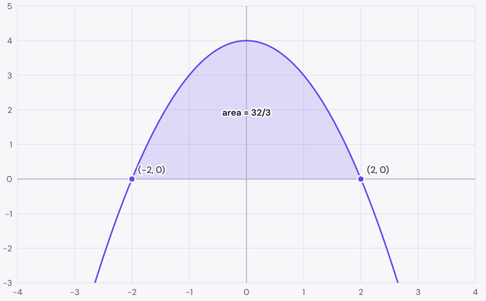
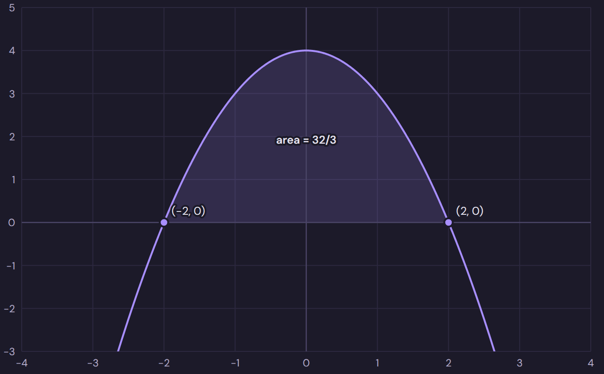

# Function plot

## Purpose

Draws curves y = f(x) on the plane, for explaining maths: one or several
functions, a shaded area (an integral under a curve, the region between two
curves, the half-plane of an inequality), marked points (roots,
intersections, extrema) and reference lines (asymptotes, bounds). Pick it
when the answer is about the *shape* of a function. It is not for measured
data over time (price-chart) or for points without a formula.

## Contract

[function-plot.contract.json](function-plot.contract.json) is the authority
(format 2: plain data, inline in the view spec).

| field | type | required | meaning |
|---|---|---|---|
| `functions[]` | `{ id?, fn, label?, domain? }`, 1–6 | yes | `fn` is y as an expression in x, parsed by src/expr.ts, never evaluated as code |
| `areas[]` | `{ above, below, from?, to?, label? }`, up to 6 | no | edges: a function's id, `axis`, `top`, `bottom` |
| `points[]` | `{ x, y? , on?, label? }`, up to 24 | no | `on` puts the point on a function at x |
| `lines[]` | `{ x }` or `{ y }`, with `label?`, up to 8 | no | reference lines across the view |

Options: `x` (default −10 to 10), `y` (null fits the curves' middle 96 %),
`xTicks` (`number` or `pi`), `grid`, `xLabel`, `yLabel`, `title`.

**Expressions.** Numbers, `x`, `pi` (π), `e`, `tau`; `+ - * / ^` (and `**`),
unary minus, parentheses, `|x|`; implicit multiplication (`2x`, `3(x+1)`,
`x sin(x)`); `sin cos tan asin acos atan sinh cosh tanh sec csc cot sqrt cbrt
abs exp ln log log2 log10 floor ceil round sign`, `min max pow atan2`; a
one-argument function may skip its parentheses (`sin x`). `-x^2` is −(x²);
`^` is right-associative. An `=` is refused with a teaching error.

## Anatomy

Back to front.

| # | part | what it is | drawn with |
|---|---|---|---|
| 1 | **title** | `title`, when given | SVG text |
| 2 | **legend** | one key and name per function, for two or more | SVG line + text, wrapping |
| 3 | **grid** | hairlines at the ticks | SVG lines |
| 4 | **areas** | the shaded regions | SVG paths, clipped to the plot |
| 5 | **axes** | the lines through zero (or the plot's edges when zero is out of view) | SVG lines |
| 6 | **reference lines** | dashed lines x = a, y = b, with their labels | SVG lines |
| 7 | **curves** | one per function, broken at undefined values and asymptotes | SVG paths, clipped |
| 8 | **tick labels**, **axis names** | the numbers (or multiples of π) and `xLabel`/`yLabel` | SVG text |
| 9 | **area labels**, **points** | a dot ringed in the ground colour, its label beside it | SVG circle + haloed text |
| 10 | **crosshair**, **tooltip** | on hover or focus: the x, each curve's y | the hover layer (src/hover.ts) |

## Measurements

Inline in a column: the width is the column's, the height is width × 0.62
within 220–420 pt (the contract's `size`; rixse APS 4's medium size). The
fixtures are 640 pt (a desktop chat column) and 358 pt (a 390 pt phone's
column less its 16 pt gutters).

| part | property | value | scales with |
|---|---|---|---|
| curve | width | 2 pt, round caps and joins | fixed |
| axis | width | 1.25 pt | fixed |
| grid, reference line | width | {stroke.hairline}; reference lines 1.25 pt dashed 5 on, 4 off | fixed |
| point | radius, ring | 4.5 pt, 2 pt ring | fixed |
| area | fill | the bounding function's colour at 16 % | fixed |
| ticks | spacing | about one per 70 pt across, one per 48 pt up | the plot |
| tick label | size | 11 pt | fixed |
| label, legend | size | {type.size.label} | fixed |
| title | size | 14 pt, weight {type.weight.semibold} | fixed |
| sampling | step | every half point across the plot | the plot |

The left gutter is the widest y tick label plus 10 pt; end x tick labels hang
inward so none leaves the chart.

## Colour and type

One function draws in {theme.accent}; several take {theme.series} in its
fixed order, never cycled. Grid {theme.rule}; axes {theme.axis}; reference
lines and secondary text {theme.soft}; labels and the title {theme.ink};
rings and label halos {theme.ground}. Text never wears a series colour: the
key beside a name carries identity. The face is the host's UI face (Ava: DM
Sans; zega: Space Grotesk), from the theme.

## States

| state | when | what shows |
|---|---|---|
| empty | never: a spec needs a function | — |
| loading | never: drawing is synchronous | — |
| error | the spec fails validation | nothing; the errors go back to whoever wrote the spec |
| selected | — | None. |
| hover / press | pointer over the plot, or focus and ← → | crosshair, a dot on each curve, the tooltip |

## Interaction

| action | touch | pointer | result |
|---|---|---|---|
| inspect | press and drag across | move across | crosshair at the nearest sample, tooltip with x and each y |
| step | — | focus, then ← → | crosshair moves by a fortieth of the plot |
| dismiss | lift outside / scroll | leave, Esc, blur | crosshair and tooltip hide |

Vertical page scrolling is never captured (`touch-action: pan-y`).

## Animation

None. Charts draw in their final state.

## Accessibility

The SVG is `role="img"` with an accessible name that says what is plotted:
each function, the x and y ranges, the areas and the labelled points. It is
focusable; the tooltip is a polite live region. Text is {theme.ink} or
{theme.soft} on the host's ground (both above 4.5:1 in every theme). Two or
more series always have a legend, so no curve is told apart by colour alone.

## Parameters (gear)

None yet: inline answers have no gear. The options are the model's to set.

| section | name | control | range / values | default |
|---|---|---|---|---|

## Platform notes

- **Web:** an SVG node tree from `render()`, turned into the host's own
  elements (`toElements` with React, `toDom` without); never markup strings.
- **Desktop (Tauri):** the same web build (Ava's app).
- **iOS:** paused (Sami, 15 Nov).

## Conformance

| fixture | what it proves | tolerance |
|---|---|---|
| [web/default.json](web/default.json) | one curve, an area between it and the axis, points on it, fixed ranges (Ava) | default |
| [web/trig-zega.json](web/trig-zega.json) | two series in order, the legend, π ticks, a title (zega) | default |
| [web/asymptote-phone.json](web/asymptote-phone.json) | a broken curve at an asymptote, reference lines, a phone column | default |

## Tokens

{stroke.hairline} 1 · {type.size.label} 12 · {type.weight.semibold} 600 ·
{theme.accent}, {theme.series}, {theme.rule}, {theme.axis}, {theme.soft},
{theme.ink}, {theme.ground}: per host and mode in tokens/themes.json.
