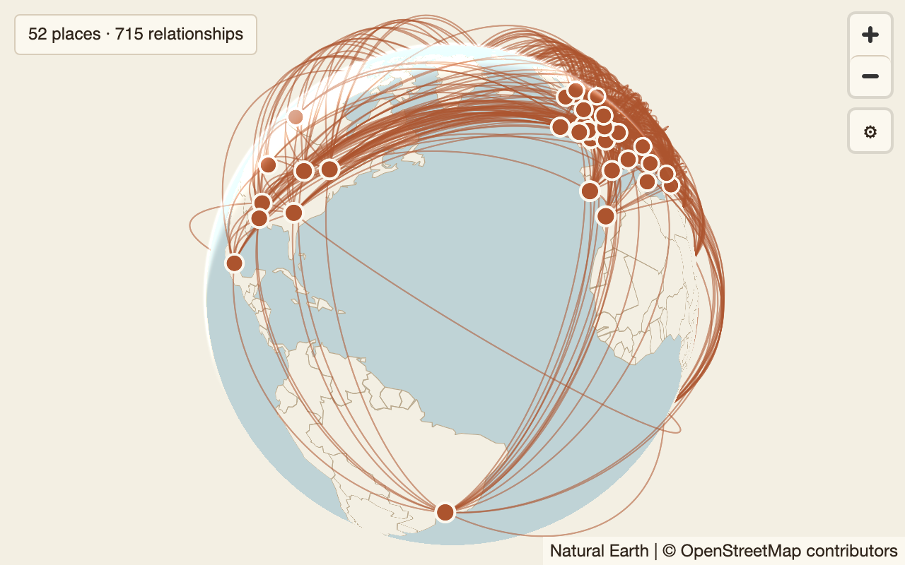
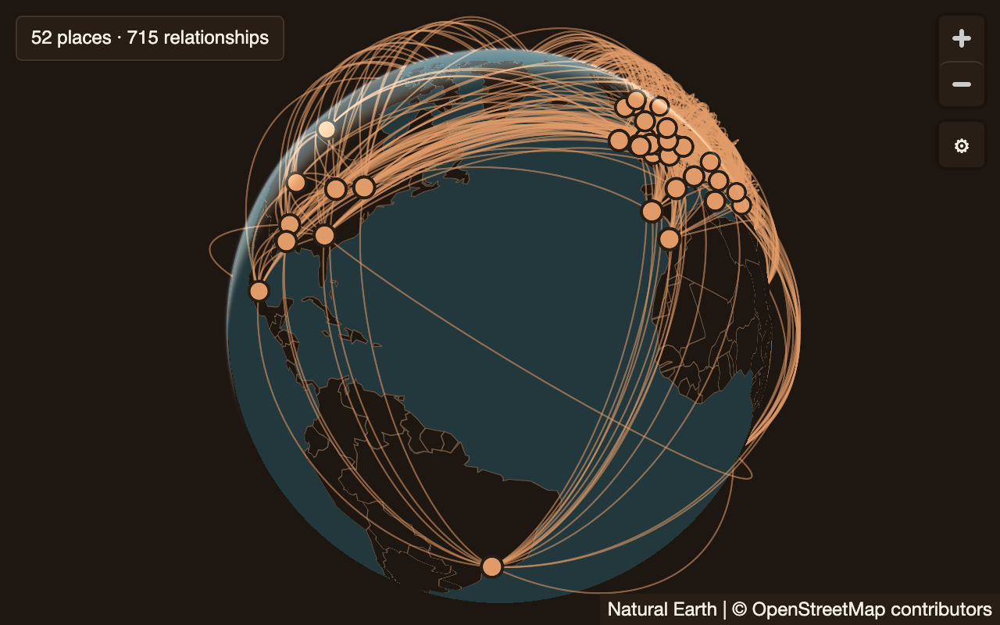

# Arcs on the globe

## Purpose

Draws routes between places as arcs lifted off a 3D globe, every endpoint a
place marker, optionally with some routes in focus over the rest as context.
Pick it when the answer is *what connects to what across the world*: flight
routes, shipping lanes, where a company's offices talk to each other. It is
not for paths with many points in order (use path-on-map) or for routes inside
one city, where the globe is flat anyway.

## Contract

[globe-arcs.contract.json](globe-arcs.contract.json) is the authority. Each
group is a place and its rows are the places it has a route to, the shape of
`Airport { at route -> Airport { at } }`. A place that appears more than once
is drawn once.

| role | per | type | required | meaning |
|---|---|---|---|---|
| `from` | group | Point | yes | where the group's routes start; animated dashes travel away from it |
| `to` | row | Point | yes | where one route ends |
| `focus` | group | Bool | no | true puts this group's routes in focus; when any group is true, every other route is context |

Surface parameters: `center` (`[lon, lat]`, default `[0, 20]`), `zoom` (0–22,
default 1.5), `tilt` (0–85°, default 0), the engine's globe camera
(zegadb/zega `zega/src/lang/globe.rs`). Display options: `lift` (0–0.5 globe
radii, default 0.18), `edges` (`animated`, `static`), `spin`.

## Anatomy

Back to front.

| # | part | what it is | drawn with |
|---|---|---|---|
| 1 | **space** | the canvas behind the planet | canvas ground |
| 2 | **atmosphere** | the glow at the planet's limb, fading as the globe zooms in | the map SDK's sky |
| 3 | **water** | the sphere's water | background fill |
| 4 | **land** | Natural Earth 1:110m countries, filled | fill layer |
| 5 | **basemap** | the street map, joining from zoom 5 as the globe flattens | the surface's vector tiles |
| 6 | **borders** | country outlines | line layer |
| 7 | **arcs** | one lifted great-circle ribbon per route; hidden where the planet is in front | custom GPU layer |
| 8 | **pulses** | with `edges: animated`, a dot running along each arc | custom GPU layer |
| 9 | **place markers** | one ringed dot per distinct place | circle layer |
| 10 | **count badge** | "52 places · 715 relationships" | canvas chrome, top-left |
| 11 | **gear** | button and panel with the contract's parameters | canvas chrome |
| 12 | **map controls** | zoom in, zoom out | map SDK, top-right (masked) |
| 13 | **attribution** | Natural Earth and basemap credits | map SDK, bottom-right (masked) |

## Measurements

Reference size: 640 × 400 pt at scale 2 (1280 × 800 pixels).

| part | property | value | scales with |
|---|---|---|---|
| arc | path | the great circle from `from` to `to` in 64 segments; an antipodal pair goes north | — |
| arc | height | `lift` × min(0.25 + 0.75·d/π, 2·d) globe radii at the middle, a sine bump along the route, for angular length d (radians) | option |
| arc | width | {stroke.arc} up to 300 routes; {stroke.arcDense} above 300 | route count |
| arc | dash (animated) | {size.dashOn} on, {size.dashOff} off, along the screen-space arc | — |
| pulse | radius | {size.pulse} | — |
| place marker | radius, ring | {size.place}, ring {stroke.placeRing} | — |
| borders | width | {stroke.border} | — |
| count badge | inset | {space.xl} from the top and left edges | fixed |
| count badge | box | padding 5 pt top and bottom, 9 pt left and right; corner {radius.sm}; border {stroke.hairline} | fixed |
| planet | fit | at `zoom` 3 or less the planet's radius is at most half the canvas's shorter side minus {space.planet}, zooming out from `zoom` only as far as needed, never in past it; the planet is centred in the canvas | canvas |
| camera | above zoom 3 | exactly `center`, `zoom`, `tilt`; no fit | — |
| basemap | from zoom | 5 | — |
| map controls | placement | top-right, {space.xl} inset | fixed |

Scaling rules: badge, gear and controls keep their size in points and their
corners. Arcs, pulses and markers keep their widths and radii in points; the
planet grows with the canvas through the fit.

## Colour and type

| part | token |
|---|---|
| space | {color.ground} |
| atmosphere | the SDK sky, blended 0.6 at zoom 0, 0.3 at zoom 5, 0 from zoom 8 |
| water | {color.water} |
| land | {color.ground} |
| borders | {color.strongRule} |
| arcs | {color.accent}; up to 300 routes at full strength, above 300 at {opacity.arcDense}. With focus: focused routes at full strength and drawn last; the others at {opacity.arcContext}, or {opacity.arcContextDense} above 300 |
| pulses | {color.accent} |
| place markers | fill {color.accent}, ring {color.panel} |
| count badge | {color.panel} fill, {color.rule} border, {color.ink} text, {type.size.label}, {type.family.ui} |

Count text: "<m> places · <k> relationships", singular for 1, parts with 0
left out, "nothing to draw" when both are 0; with focus, "<f> of <k>
relationships".

## States

| state | when | what shows |
|---|---|---|
| empty | the result has no routes | the planet, framed, with no arcs or markers; the badge reads "nothing to draw" |
| loading | the view is drawing | the previous entry stays until the new one's first complete frame; the land draws as soon as the outlines arrive |
| error: spec or data | the view spec does not bind | nothing changes; the teaching error goes to the caller |
| error: outlines | the country outlines cannot load | water, markers and arcs still draw; the notice "Country outlines unavailable. Your places are still shown.", styled as the count badge, {space.xl} from the left and 35 pt from the bottom (clear of the attribution), at most the canvas width less 20 pt |
| error: basemap | the street tiles fail | the globe keeps land and water; the notice "Base map unavailable. Countries and places are still shown." |
| error: no GPU | the platform cannot draw the globe | the notice "This device cannot draw the globe." and nothing else |
| selected | a place or an arc is chosen | the host receives the place's group or the route's row; the component draws no selection of its own |
| hover / press | pointer over a place marker or within 6 pt of an arc | pointer cursor (after an 80 ms rest); touch has no hover |

## Interaction

| action | touch | pointer | result |
|---|---|---|---|
| turn the globe | one-finger drag | drag | rotates the planet under the finger; stops auto-spin while held |
| zoom | pinch | scroll or trackpad pinch; double-click zooms in | zooms about the gesture; past zoom 11 the globe becomes the flat map |
| tilt | two-finger vertical drag | right-drag or ctrl-drag vertically | changes tilt up to 85° |
| choose a place or arc | tap | click | selects it (see States); a place wins over an arc under the same point, an arc over land |
| zoom buttons | tap | click | zoom by one level |
| gear and parameters | as path-on-map | as path-on-map | a change creates a new history entry |

The first gesture that moves the camera hands it to the reader: from then on
the planet fit and centring stop, and resizing the canvas keeps the camera
exactly where the reader left it.

## Animation

- `edges: animated`: dashes run from each route's start towards its end at
  {motion.rate.dashSpeed}, and a pulse runs along each route at
  {motion.rate.pulseSpeed}; both loop without end. With focus, only focused
  routes animate; context routes are still.
- `spin: true`: the camera turns west at {motion.rate.spin} (the globe turns
  east) at zoom 1.5 and below, halving with each zoom level above that, and
  stopping as the globe flattens; paused while a gesture is held.
- Loads, restores and parameter changes jump ({motion.duration.instant}).
- Reduced motion: `edges` draws as `static` and `spin` as false, whatever the
  spec says; the spec itself is not changed.

## Accessibility

- The canvas is one labelled region, "Globe of countries, places and
  relationships", whose description is the count text.
- Places and arcs are reachable without a pointer: the host's table view of
  the same result is the accessible alternative, one row per route.
- Contrast: {color.accent} markers with the {color.panel} ring stand out
  against both {color.water} (3.3:1 light, 5.3:1 dark) and {color.ground}
  (4.49:1 light, 7.7:1 dark). Arcs above 300 routes, at {opacity.arcDense},
  read as a network rather than as single routes, by design.
- Reduced motion: see Animation.

## Parameters (gear)

Exactly the contract's settings, surface first, as path-on-map.

| section | name | control | range / values | default |
|---|---|---|---|---|
| surface | `center` | JSON text field | `[lon, lat]` | `[0, 20]` |
| surface | `zoom` | slider, step 0.1 | 0–22 | 1.5 |
| surface | `tilt` | slider, step 1 | 0–85 | 0 |
| options | `lift` | slider, step 0.01, value shown to 2 places | 0–0.5 | 0.18 |
| options | `edges` | menu | animated, static | animated |
| options | `spin` | checkbox | — | false |

## Platform notes

- **Web:** MapLibre GL JS `globe` projection; the arcs are one custom WebGL2
  layer (one draw call for every arc; the sphere drawn depth-only first so
  arcs behind the planet fail the depth test); markers and land are style
  layers.
- **Desktop (Tauri):** the web build, unchanged.
- **iOS:** the native map view's globe projection with the same style JSON;
  arcs as a Metal custom layer computing the same great circle, height and
  ribbon, fed the same per-arc basis, and depth-tested against the sphere the
  same way. Only the drawing API differs; lift, widths, dash and alpha are the
  tokens and formulas above.

## Conformance

| fixture | what it proves | tolerance |
|---|---|---|
| [default](fixtures/default.json) | 715 routes over the dense threshold: thin, translucent arcs; place markers; planet fit at a tilted camera; count badge | default |
| [focus-hub](fixtures/focus-hub.json) | focus: 10 focused routes on top at full strength, the rest at context strength; the "of" count; a higher lift | default |

Each fixture renders in both themes against its two reference images, with
`edges: static` (a moving dash has no single frame to compare; the animated
form is checked by the platforms' own tests of dash phase and speed). Masks
(every fixture): the map controls (top-right, 52 × 116 pt) and the
attribution (bottom-right, 280 × 24 pt).

Known gaps in the reference implementation, which the web must close and
other platforms must not copy: the gear sits in the map control stack
(top-right, masked) with a reset button instead of on the canvas top-left
with the contract's parameters; the badge sits where the canvas gear goes,
and moves when the component joins the canvas; reduced motion does not yet
turn `spin` off; the no-GPU text reads "WebGL2 unavailable. This browser
cannot draw the globe."; {type.family.ui} resolves to each operating system's
own face.

## Tokens

{color.ground}, {color.water}, {color.strongRule}, {color.accent},
{color.panel}, {color.rule}, {color.ink}, {space.xl}, {space.planet},
{radius.sm}, {stroke.hairline}, {stroke.arc}, {stroke.arcDense},
{stroke.border}, {stroke.placeRing}, {opacity.arcDense},
{opacity.arcContext}, {opacity.arcContextDense}, {size.place},
{size.pulse}, {size.dashOn}, {size.dashOff}, {type.size.label},
{type.family.ui}, {motion.rate.dashSpeed}, {motion.rate.pulseSpeed},
{motion.rate.spin}, {motion.duration.instant}.
