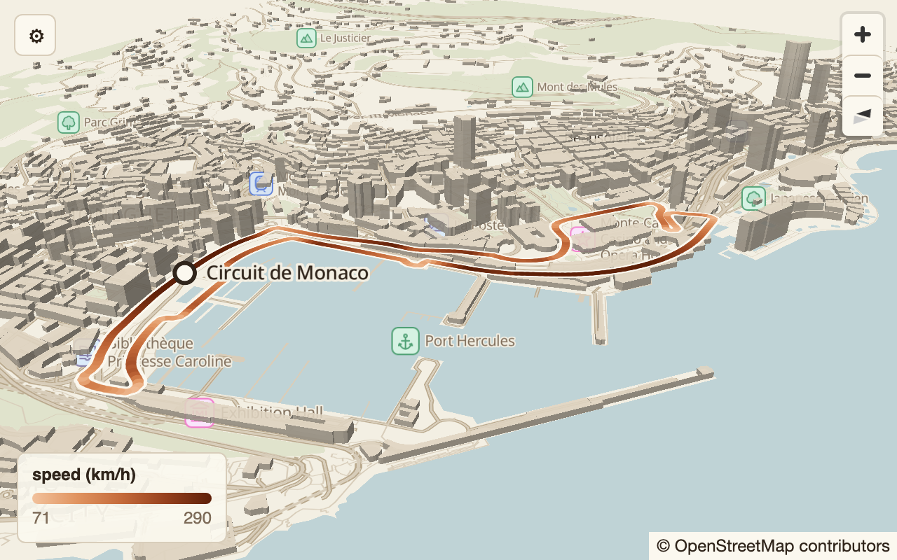
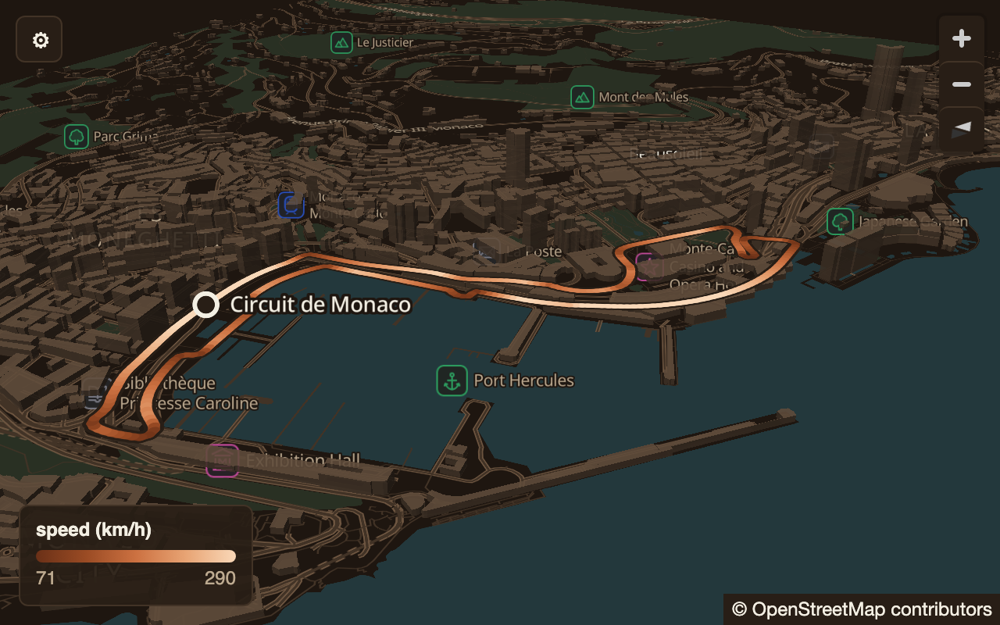

# Path on map

## Purpose

Draws ordered paths (a race lap, a delivery route, a run) on the street map
with 3D buildings, each segment coloured by an optional value at its start
point, with a labelled start marker. Pick it when the answer is *where
something went, in order*, and optionally *how a number changed along the
way* (speed, distance, sector). It is not for unordered points (a place map)
or for routes between distant places, where the earth's curvature matters
(use globe-arcs).

## Contract

[path-on-map.contract.json](path-on-map.contract.json) is the authority.
Rows are the points of a path in path order (select them with `order by`);
ungrouped, all rows are one path; grouped, each group is one path. At least 2
rows per path.

| role | per | type | required | meaning |
|---|---|---|---|---|
| `path` | row | Point | yes | the point's position; the first row is the start |
| `value` | row | Float | no | a number per point; a segment takes its start point's colour |
| `label` | group | String | no | the path's name, drawn at its start |

Surface parameters: `bounds` (`[w, s, e, n]` or null: frame the paths),
`basemap` (`auto`, `cities`, `monaco`). Display options: `colorScale`,
`valueUnit`, `lineWidth` (1–16 pt, default 6), `view` (`2d`, `3d`), `bearing`
(−180–180°), `showBuildings`.

## Anatomy

Back to front.

| # | part | what it is | drawn with |
|---|---|---|---|
| 1 | **basemap** | the street map: land, water, parks, roads, labels, POI icons | the surface's vector tiles and style (APS 9 basemap flavour of the theme) |
| 2 | **buildings** | building footprints extruded to their mapped heights | the surface; shown or hidden by `showBuildings` |
| 3 | **casing** | a halo under the whole path so it reads over any map | one line per segment |
| 4 | **path** | the coloured line, one segment per consecutive pair of rows | one line per segment, round caps and joins |
| 5 | **start marker** | a ring at each path's first point | circle |
| 6 | **path label** | the group's `label`, right of the start marker | map text |
| 7 | **legend** | the value's name and unit, the colour ramp, its low and high ends | canvas overlay, bottom-left |
| 8 | **gear** | button and panel with the contract's parameters | canvas chrome, top-left |
| 9 | **map controls** | zoom in, zoom out, compass | map SDK, top-right (masked) |
| 10 | **attribution** | the basemap's required credit | map SDK, bottom-right (masked) |

## Measurements

Reference size: 640 × 400 pt at scale 2 (1280 × 800 pixels).

| part | property | value | scales with |
|---|---|---|---|
| casing | width | `lineWidth` + {stroke.casing} | option |
| path | width | `lineWidth` (default 6 pt) | option |
| path | caps, joins | round, round | — |
| start marker | radius | the larger of {size.markerMin} and `lineWidth` | option |
| start marker | outline | {stroke.marker} | — |
| path label | size | {type.size.mapLabel}, {type.family.map} | — |
| path label | position | anchored at its left edge, 1.1 em (15.4 pt) right of the start point, vertically centred on it | — |
| path label | halo | {stroke.labelHalo} | — |
| legend | inset | {space.xxl} from the left and bottom edges | fixed |
| legend | box | at least {size.legendMin} wide; padding {space.lg} top and bottom, {space.xl} left and right; corner {radius.md}; border {stroke.hairline} | fixed |
| legend | title to bar | 5 pt | fixed |
| legend | bar | {size.legendBar} high, full box width, corner {radius.sm} | fixed |
| legend | bar to ends | {space.xs} | fixed |
| gear | inset | {space.xl} from the top and left edges | fixed |
| gear | button | {size.gearButton} square, corner {radius.md}, border {stroke.hairline}, glyph ⚙ at {type.size.gearGlyph} | fixed |
| gear | panel | {space.md} below the button, {size.gearPanel} wide, padding {space.lg} × {space.xl}, corner {radius.md}, border {stroke.hairline} | fixed |
| gear | row | three columns: name {size.gearLabel}, control (the rest), value {size.gearValue}; gap {space.md}; {space.sm} above and below | fixed |
| gear | section title | {space.md} above, {space.xxs} below | fixed |
| camera | pitch | `view: 3d` 60°, `view: 2d` 0° | option |
| camera | framing | every point of every path (or `bounds`) fitted in the view as rotated by `bearing`, with padding the smallest of {space.frame}, a sixth of the width and a sixth of the height; `3d` then zooms out by 0.3 levels; never past zoom 17 | canvas |
| map controls | placement | top-right, {space.xl} inset | fixed |

Scaling rules: the legend, gear and map controls keep their size in points at
every canvas size and stay in their corners. The path, marker and label keep
their size in points; the camera, not the marks, changes with the canvas: a
larger canvas frames the same paths at a higher zoom. The basemap fills the
canvas.

## Colour and type

| part | light and dark (each theme's value of the token) |
|---|---|
| canvas ground | {color.ground} |
| buildings | {color.rule} at {opacity.buildings}; a building with no height is 9 m |
| casing | {color.panel} at {opacity.casing} |
| path, `colorScale: sequential` | {ramp.sequential}, the value's minimum at the first stop and maximum at the last, linear in RGB between stops |
| path, `colorScale: diverging` | {ramp.diverging}; the middle stop is 0 when the values span 0, else their midpoint; each half is linear from its end to the middle |
| path, `colorScale: solid` or no `value` | {color.accent} |
| path, a point with no value | {color.accent} |
| start marker | fill {color.panel}, outline {color.ink} |
| path label | {color.ink}, halo {color.ground}, {type.family.map} |
| legend | background {color.panel} at {opacity.legend}; border {color.rule}; title {color.ink} {type.size.label} {type.weight.semibold}; ends {color.soft} {type.size.label} with tabular numerals; line height {type.lineHeight.tight}; family {type.family.ui} |
| gear | button: {color.panel} fill, {color.rule} border, {color.ink} glyph. Panel: {color.panel} at {opacity.gearPanel}, {color.rule} border, text {color.ink} {type.size.label}. Section titles: {color.soft}, {type.size.caption}, upper case, tracking {type.tracking.caption}. Values: {color.soft} {type.weight.medium}, right-aligned, tabular. Inputs: {color.ground} fill, {color.rule} border, {radius.sm}; slider and checkbox tint {color.accent}. Error: {color.accent} {type.family.mono} {type.size.gearError}, line height {type.lineHeight.code} |

Legend text: the title is the last segment of the `value` binding's field path
(`speed` for `speed`, `speed` for `lap.speed`), followed by ` (unit)` when
`valueUnit` is set. The ends are the data's minimum and maximum: whole
numbers when the range is 10 or more, else 3 significant digits.

## States

| state | when | what shows |
|---|---|---|
| empty | the canvas has no entry yet | {color.ground} only: no basemap, legend, gear or controls |
| loading | a load or restore is drawing | the previous entry stays on screen until the new one's first complete frame; no spinner. A swap has {motion.duration.swapBudget} as its target |
| error: spec or data | the view spec does not bind (a path with fewer than 2 rows, a misspelt field, an option out of range) | nothing changes on the canvas; the teaching error (code, at, message, help, fix) goes to the caller, and to the gear's error line when the change came from the gear |
| error: draw | the basemap or a source fails to load | the previous entry is drawn again; the error goes to the caller |
| error: no GPU | the platform cannot draw the map | the canvas shows "This device cannot draw the map." in {color.ink} {type.size.label} at the bottom-left inset |
| selected | — | None: path-on-map has no selection |
| hover / press | pointer over the gear button or a map control | the platform's standard pressed feedback on those controls only; marks do not react |

## Interaction

| action | touch | pointer | result |
|---|---|---|---|
| pan | one-finger drag | drag | moves the camera |
| zoom | pinch | scroll wheel or trackpad pinch; double-click zooms in | changes zoom about the gesture's centre |
| rotate | two-finger twist | right-drag or ctrl-drag sideways | changes bearing |
| tilt | two-finger vertical drag | right-drag or ctrl-drag vertically | changes pitch, up to 70° |
| zoom buttons, compass | tap | click | zoom by one level; compass resets bearing and pitch to north-up |
| open or close the gear | tap the gear | click the gear, or Enter/Space when focused | shows or hides the panel |
| change a parameter | the control | the control | creates a new history entry with that value; the canvas redraws; invalid input shows the gear error and changes nothing |

Moving the camera by hand is not a parameter change: it creates no entry, and
a restore puts the entry's own camera back.

## Animation

None. Loads, restores, theme changes and parameter changes jump straight to
the new frame ({motion.duration.instant}): the camera does not fly and paths
do not draw on. Map gestures follow the platform map's own inertia. Reduced
motion changes nothing because nothing animates.

## Accessibility

- The canvas is one labelled region, "Graph component canvas", whose
  description is the drawn view: "<label, or 'Path'> on the map, <n> points,
  coloured by <value field> from <low> to <high> <unit>" (no colour clause
  when solid).
- The gear button's accessible name is "view settings", with its expanded
  state; each control is named `<section>.<name>` (`options.lineWidth`) and
  carries the contract's description as its hint. The gear error line is a
  live status region.
- Focus order: gear button, gear controls (when open), map controls.
- Contrast: text on the legend and gear passes 4.5:1 in both themes
  ({color.ink} on {color.panel} 14:1; {color.soft} on {color.panel} 4.7:1
  light, 7.2:1 dark). The solid path, {color.accent} on {color.ground}, is
  4.49:1 light and 7.7:1 dark, above the 3:1 that graphics need. The low
  end of {ramp.sequential} and the middle
  of {ramp.diverging} fall under 3:1 against the ground (1.4:1 and 1.6:1,
  light); the casing separates the line from the map but not its colour from
  the ground. Colour is never the only carrier: the legend's numbers state the
  range.
- Reduced motion: nothing animates (see Animation).

## Parameters (gear)

Exactly the contract's settings, surface first, in contract order. The
control follows from each setting's schema: an `enum` is a menu, a boolean a
checkbox, a number with both bounds a slider with its value shown, anything
else a JSON text field checked on commit.

| section | name | control | range / values | default |
|---|---|---|---|---|
| surface | `bounds` | JSON text field | `[w, s, e, n]` with w < e, s < n, or null | null |
| surface | `basemap` | menu | auto, cities, monaco | auto |
| options | `colorScale` | menu | sequential, diverging, solid | sequential |
| options | `valueUnit` | menu | ft, m, deg, pct, fraction, km/h, yd, s, null | null |
| options | `lineWidth` | slider, step 0.1 | 1–16 | 6 |
| options | `view` | menu | 2d, 3d | 3d |
| options | `bearing` | slider, step 1 | −180–180 | 0 |
| options | `showBuildings` | checkbox | — | true |

## Platform notes

- **Web:** MapLibre GL JS with the surface's PMTiles archives; paths are line
  layers fed by GeoJSON, legend and gear are DOM over the map. Colours come
  from generated/tokens.js (paint properties) and generated/tokens.css
  (chrome).
- **Desktop (Tauri):** the web build in the Tauri webview, unchanged. Same
  fixtures, same references.
- **iOS:** a native map view on the same style JSON and the same tile
  archives (see the README's open question on MapLibre Native vs Mapbox);
  paths as line layers with the same paint expressions; legend and gear in
  SwiftUI over the map, from generated/Tokens.swift. The gear panel is the
  same overlay, not a sheet.

## Conformance

| fixture | what it proves | tolerance |
|---|---|---|
| [default](fixtures/default.json) | sequential ramp, 3D camera with bearing, buildings, start marker and label, legend with unit | default |
| [dist-2d-diverging](fixtures/dist-2d-diverging.json) | diverging ramp around the midpoint, straight-down camera, wider line, legend without a label binding | default |
| [solid-no-buildings](fixtures/solid-no-buildings.json) | accent line, buildings off, no legend | default |

Each fixture renders in both themes against its two reference images.

Known gaps in the reference implementation (zegadb/zega at 11cff10), which
the web must close and other platforms must not copy: the no-GPU text reads
"WebGL2 unavailable. This browser cannot draw the map."; the canvas has no
view description (the demo page labels its host "Graph component canvas");
{type.family.ui} resolves to each operating system's own face. Masks
(every fixture): the map controls (top-right, 52 × 116 pt) and the
attribution (bottom-right, 280 × 24 pt), whose look each map SDK owns. The
basemap in every reference is zegadb/zega's committed test extract (tiles,
fonts, sprites under browser/tests/fixtures/) plus data/monaco.pmtiles; a
platform renders fixtures from the same files.

## Tokens

{color.ground}, {color.panel}, {color.rule}, {color.ink}, {color.soft},
{color.accent}, {ramp.sequential}, {ramp.diverging}, {space.xxs},
{space.xs}, {space.sm}, {space.md}, {space.lg}, {space.xl}, {space.xxl},
{space.frame}, {radius.sm}, {radius.md}, {stroke.hairline},
{stroke.marker}, {stroke.casing}, {stroke.labelHalo}, {opacity.buildings},
{opacity.casing}, {opacity.legend}, {opacity.gearPanel}, {size.gearButton},
{size.gearPanel}, {size.gearLabel}, {size.gearValue}, {size.legendMin},
{size.legendBar}, {size.markerMin}, {type.family.ui}, {type.family.mono},
{type.family.map}, {type.size.caption}, {type.size.gearError},
{type.size.label}, {type.size.gearGlyph}, {type.size.mapLabel},
{type.weight.medium}, {type.weight.semibold}, {type.lineHeight.tight},
{type.lineHeight.code}, {type.tracking.caption}, {motion.duration.instant},
{motion.duration.swapBudget}.
