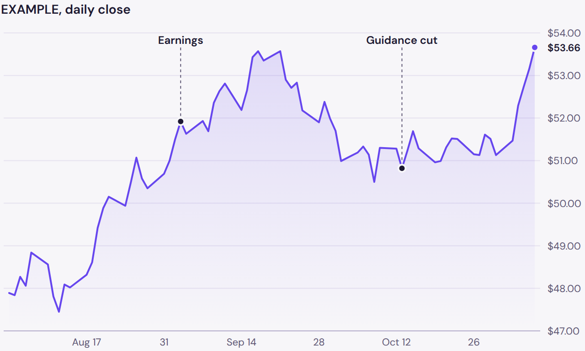
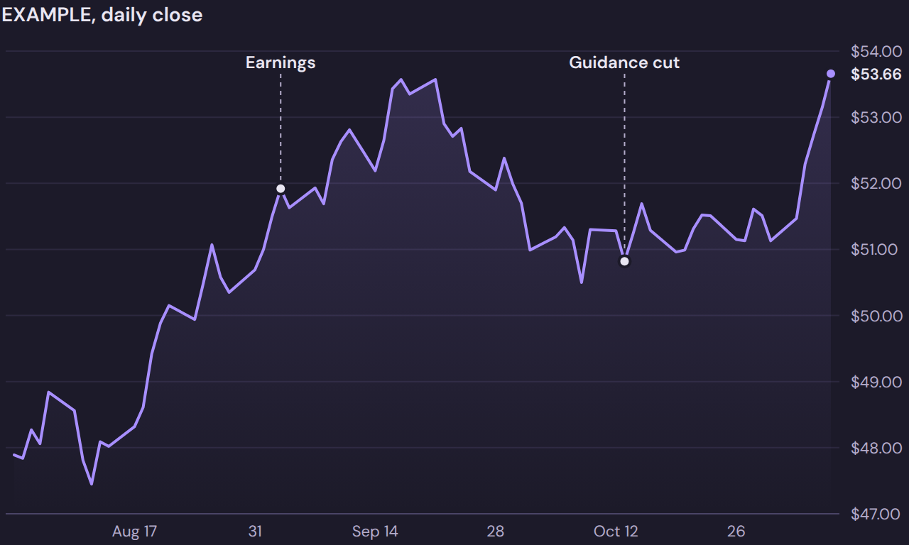

# Price chart

## Purpose

Draws a price over time: a line (one series, or up to four compared as %
change), or candlesticks (open, high, low, close per period), with volume
underneath and annotated moments (earnings, a split, news). Pick it when the
answer is how a traded price moved. It is not for a value that isn't a price
or a level (use a line chart when there is one) and never draws two price
axes: series of different prices compare as % change on one.

## Contract

[price-chart.contract.json](price-chart.contract.json) is the authority
(format 2: plain data, inline in the view spec).

| field | type | required | meaning |
|---|---|---|---|
| `series[]` | `{ label?, points[] }`, 1–4 | yes | one per instrument |
| `points[]` | `{ t, c, o?, h?, l?, v? }`, 2–2000 | yes | oldest first; `t` an ISO 8601 date or date-time (UTC unless it has an offset) |
| `annotations[]` | `{ t, label }`, up to 8 | no | moments on the first series |

Options: `kind` (`line`, `candle`: needs o, h, l on every point and one
series), `scale` (`price`, `percent`), `volume` (needs v on the first
series), `currency` (ISO 4217), `title`. Validation also holds l ≤ o, c ≤ h,
strictly rising times and annotations inside the first series' time.

## Anatomy

Back to front.

| # | part | what it is | drawn with |
|---|---|---|---|
| 1 | **title**, **legend** | `title`; one key and name per series, for two or more | SVG text, lines |
| 2 | **grid** | hairlines at the price ticks | SVG lines |
| 3 | **baseline** | the price band's bottom edge (and 0 % on a percent scale) | SVG line |
| 4 | **volume** | a bar per period in its own band, the band's maximum labelled | SVG rects |
| 5 | **wash** | under a single line, its colour fading to nothing | SVG gradient path |
| 6 | **lines** or **candles** | the closes; or wick and body per period | SVG paths; lines and rects |
| 7 | **annotations** | a dot on the moment's point, a dashed rule up to its label | SVG circle, line, haloed text |
| 8 | **ends** | a dot on each line's last point; the last price on the axis, emphasised | SVG circle, text |
| 9 | **price axis**, **time axis** | price ticks at the right; calendar ticks at the bottom, the first with its context | SVG text |
| 10 | **crosshair**, **tooltip** | on hover or focus: the date, each series' value (O H L C for a candle), the volume | the hover layer (src/hover.ts) |

## Measurements

Inline in a column: width the column's, height width × 0.6 within 240–440 pt.

| part | property | value | scales with |
|---|---|---|---|
| line | width | 2 pt, round | fixed |
| candle | body width | 70 % of a period's slot, at most 24 pt | the data |
| candle | wick | 1.25 pt | fixed |
| volume band | height | a fifth of the plot, 8 pt below the prices | the plot |
| volume bar | opacity | 45 % of up or down | fixed |
| wash | opacity | 16 % at the line, 0 at the baseline | fixed |
| end dot, annotation dot | radius, ring | 4 pt, 2 pt | fixed |
| price ticks | spacing | about one per 46 pt | the plot |
| time ticks | spacing | about one per 76 pt, on day, week, month or year boundaries (UTC) | the plot |
| tick label, legend | size | 11 pt; {type.size.label} | fixed |

Candles sit one per period, evenly, so weekends and holidays leave no gaps;
lines sit at their times.

## Colour and type

A single line draws in {theme.accent}; several take {theme.series} in order.
Candles and volume use {theme.up} and {theme.down}; a rising candle is
hollow (filled with {theme.ground}) and a falling one filled, so direction
never rests on colour alone. Grid {theme.rule}, baseline {theme.axis}, ticks
{theme.soft}, the last price, annotations and the title {theme.ink}.

## States

| state | when | what shows |
|---|---|---|
| empty | never: a series needs two points | — |
| loading | never | — |
| error | the spec fails validation | nothing; the errors go back to whoever wrote the spec |
| selected | — | None. |
| hover / press | pointer over the plot, or focus and ← → | crosshair, a dot per series, the tooltip |

## Interaction

| action | touch | pointer | result |
|---|---|---|---|
| inspect | press and drag across | move across | crosshair at the nearest period, its values |
| step | — | focus, then ← → | the crosshair moves by periods |
| dismiss | scroll away | leave, Esc, blur | hidden |

## Animation

None.

## Accessibility

`role="img"` with a name that says the instrument, the time span and, for
one series, the first and last close and the change. Focusable; the tooltip
is a polite live region. Up and down differ by fill as well as colour; series
have a legend.

## Parameters (gear)

None yet: inline answers have no gear.

| section | name | control | range / values | default |
|---|---|---|---|---|

## Platform notes

- **Web:** an SVG node tree from `render()`; dates are formatted with Intl in
  UTC, in the host's language (en-CA, fr-CA).
- **Desktop (Tauri):** the same web build (Ava's app).
- **iOS:** paused (Sami, 15 Nov).

## Conformance

| fixture | what it proves | tolerance |
|---|---|---|
| [web/default.json](web/default.json) | a line, the wash, the last price, annotations, a title (Ava; example data) | default |
| [web/candles-zega.json](web/candles-zega.json) | hollow and filled candles, volume (zega; example data) | default |
| [web/percent-phone.json](web/percent-phone.json) | two series as % change on one axis, a legend, a phone column | default |

## Tokens

{type.size.label} 12 · {theme.accent}, {theme.series}, {theme.up},
{theme.down}, {theme.rule}, {theme.axis}, {theme.soft}, {theme.ink},
{theme.ground}: per host and mode in tokens/themes.json.
