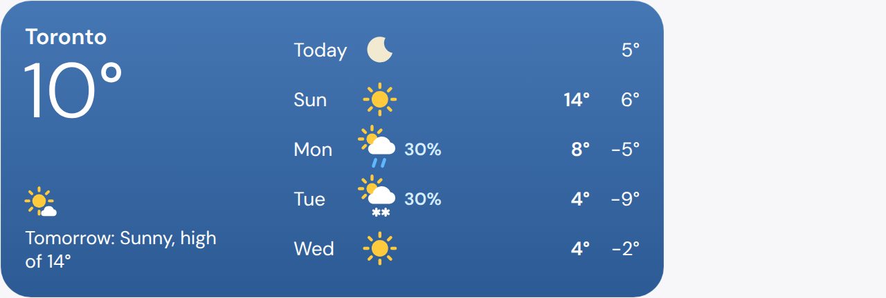
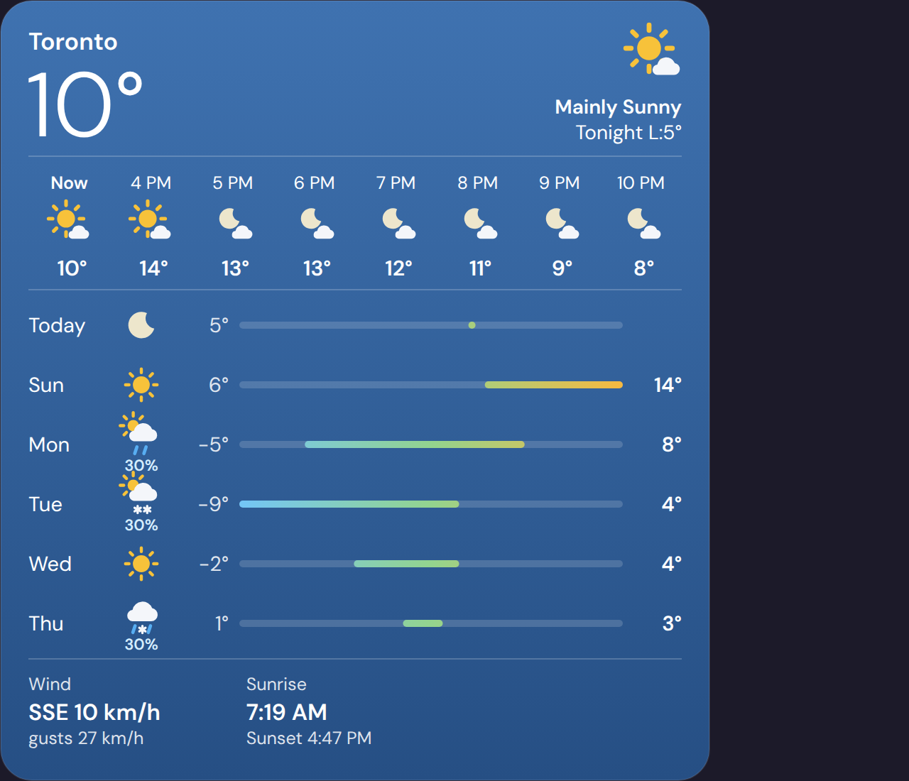

# Weather

## Purpose

One place's weather at a glance, as a card: the temperature now, the sky, how tomorrow
compares and the days ahead (`compact`); or also the next hours and the details: feels like,
wind, the chance of precipitation, sunrise and sunset (`full`). A host shows it when someone
asks only about the weather (Ava: "what's it like in Toronto?"); the reply's words stay one
short sentence beside it. It is drawn from a forecast the host read itself (Ava: Environment
and Climate Change Canada), never from numbers a model wrote. It is not a chart of a forecast
over time, and it shows no warnings: a host shows the source's alerts as the source wrote them,
above the card.

## Contract

[weather.contract.json](weather.contract.json). Temperatures are °C; times carry the place's
UTC offset, so the card shows the place's own clock wherever it is drawn.

| role | per | type | required | meaning |
|---|---|---|---|---|
| place | card | string | yes | the place's name, as the source names it |
| today | card | date | yes | the place's own date: "Today" and tomorrow's line follow from it |
| now | card | temp_c, condition, icon, night, feels_c, wind, observed | no | the latest observation |
| hours | card | at, temp_c, icon, night, pop | no | the next hours, in order |
| days | card | date, high_c, low_c, icon, night, condition, pop | no | one per day from today: the day's sky, high and chance, the night's low |
| sun | card | rise, set | no | today's sunrise and sunset |
| stale | card | as_of (words), offline | no | the card isn't the latest reading |
| summary | card | string | no | the compact card's line; otherwise the card writes it from the days |

At least one of `now`, `hours`, `days`. `pop` is the source's chance of precipitation: given or
absent, never 0 for unknown. Options: `size` (`compact`, `full`) and `lang` (`en`, `fr`; the
host's language when null).

**Glyphs.** `icon` is one of our own fourteen kinds; `night` swaps the sun for the moon. ECCC's
codes map to them in one table, `ECCC_ICONS` (with `ECCC_TEXT` for a period with only words),
exported by the entry; a host reading ECCC reads that table rather than copying it:

| kind | ECCC codes |
|---|---|
| clear | 00 (day), 30 (night) |
| mainly-clear | 01, 05 (day); 31, 35 (night) |
| partly-cloudy | 02, 03, 04 (day); 32, 33, 34 (night); 22 |
| cloudy | 10 |
| showers | 06 (day), 36 (night) |
| rain | 11, 12, 13, 28 |
| freezing-rain | 14, 27 |
| mix (rain and snow) | 07 (day), 37 (night), 15 |
| flurries | 08 (day), 38 (night), 26 |
| snow | 16, 17, 18 |
| thunderstorm | 09 (day), 39 (night), 19, 46, 47 |
| fog | 23, 24, 44, 45 |
| wind | 41, 42, 43, 48 |
| blowing-snow | 25, 40 |

## Anatomy

| # | part | what it is | drawn with |
|---|---|---|---|
| 1 | sky | the card: a rounded rectangle, a soft vertical gradient (a lighter top easing to a deeper bottom, toward slate) by condition and day or night, a hairline edge | rect, linearGradient |
| 2 | place | the place's name, top left | text, semibold |
| 3 | stale | when not the latest: a small clock and "Offline · as of …" (or "As of …") under the place, one or two lines | circle, path, text |
| 4 | now | the temperature now, large and light | text, light |
| 5 | header (full) | the sky's glyph, its words and today's high and low ("H:8° L:−1°"; "Tonight L:5°" once only tonight is left), top right | glyph, text |
| 6 | line (compact) | the glyph now and one line on tomorrow ("Warmer tomorrow, with a high of 14°"), bottom left | glyph, text |
| 7 | hours (full) | Now, then each next hour: its time (5 PM; 17 h), glyph, chance (when shown) and temperature | text, glyph |
| 8 | days (compact) | one row per day: its name, glyph, chance beside it (when shown), then high and low tight at the right | text, glyph |
| 9 | days (full) | one row per day on a fixed grid: name, glyph with the chance under it (when shown), low, the range bar, high | text, glyph, rect |
| 10 | range bar (full) | a faint track for the week's lowest to highest; the day's low-to-high on it, filled cool to mild to warm across the week; a dot when only one is given | rect, circle, linearGradient |
| 11 | details (full) | feels like, wind (gusts under it), precipitation, sunrise (sunset under it): only those given | text |

## Measurements

The card is the column's width up to 480 pt (compact) or 500 pt (full), left in the column;
its height follows what it holds. Radius 22 pt. Padding 18 pt (compact) or 20 pt (full), 16 pt
under 400 pt.

| part | property | value | scales with |
|---|---|---|---|
| place | size | 16 pt (compact), 17 pt (full) | fixed |
| now | size | 56 pt, 50 pt under 400 pt (compact); 64 pt, 56 pt under 400 pt (full) | fixed |
| compact columns | split | 40 % now, 60 % days, 16 pt between; under 320 pt one column, the days stacked under the line | width |
| day row | height | 36 pt (compact); 38 pt, 42 pt when a chance sits under a glyph (full); 5 rows (compact), 6 (full) | fixed |
| glyph | size | 31 pt in rows, 36 pt in hours, 28 pt in the compact line, 48 pt in the header | fixed |
| range bar | track | from the glyph column plus a low's width to a high's width from the right edge; 5 pt tall, round ends | width |
| hours | columns | one per 56 pt of the inner width, 5 to 8 | width |
| details | per row | 3 or 4 from 440 pt, else 2 | width |
| labels | size | 12.5 to 14.5 pt | fixed |

## Colour and type

Everything on the card is {theme.weather}: the sky (eight, by the condition now, else the next
hour's, else today's: clear-day, partly-day, overcast-day, rain-day, snow-day, storm,
clear-night, cloudy-night), each a lighter top easing to a deeper bottom; the text in its ink,
white in both chat modes; the details' labels in ink at 86 % opacity (they sit low, on the
deeper sky; everything nearer the top is full ink, the lows told from the highs by weight); the
chance of precipitation in its light blue; the glyphs two-tone and multi-colour (a yellow sun, a
pale moon, white clouds with a light grey one behind, blue drops, white snow, a yellow bolt);
the range bar's track in ink at 16 % and its fill the three-stop range (cool, mild, warm). The
dark mode's skies are a little deeper than the light mode's. No text shadow: every text holds
its contrast without one. Type is the host's UI face (DM Sans for Ava):
the temperature now at weight 300, the place, highs and values at 600.

## States

| state | when | what shows |
|---|---|---|
| empty | no now, hours or days | nothing: validate() refuses it |
| loading | | the host's own; the card is drawn whole or not at all |
| error | a spec that fails validate() | nothing; the host says one plain sentence |
| stale | `stale` given | the clock and "Offline · as of …" under the place, small: the only "as of" (the host leaves it off its source line when the card shows it) |
| missing values | a day without a high, a night without a glyph, no gusts | that value is left out; nothing is made up |
| selected | | none |
| hover / press | | none |

## Interaction

None: the card is a still picture.

| action | touch | pointer | result |
|---|---|---|---|
| none | | | |

## Animation

None.

## Accessibility

The SVG is `role="img"` with an accessible name of a few sentences: the place and now, each
day's words, high, low and chance, and the "as of" when stale. Every piece of text holds 4.5:1
(3:1 for large text: 24 pt, or 18.66 pt semibold) against the sky right behind it, wherever it
sits on the card, for every sky, host, mode, size and width (the tests draw each and check each
text at its baseline and its cap height), so the card reads the same on a light or a dark page. Glyphs are `aria-hidden`; their
words are in the name.

## Parameters (gear)

None: the card has no gear. `size` and `lang` are the host's choice.

| section | name | control | range / values | default |
|---|---|---|---|---|
| | | | | |

## Platform notes

- **Web:** SVG through `render()` from "@zegadb/components/weather", which also checks and
  draws every main-entry component; the main entry doesn't carry the weather. No credit is drawn:
  the host shows its source's credit once, under the card, as Ava does with ECCC's line, and
  never as an "edit" link (as with the basemap's credit).
- **Desktop (Tauri):** the same web build; the host self-hosts its face at weights 300, 400 and 600.
- **iOS:** paused.

## Conformance

| fixture | what it proves | tolerance |
|---|---|---|
| [web/default.json](web/default.json) | compact: the place, now, the line, five days, a chance from the source's words (ECCC's Toronto page, recorded) | default |
| [web/compact-phone.json](web/compact-phone.json) | compact at a phone's column | default |
| [web/compact-narrow.json](web/compact-narrow.json) | compact under 320 pt (a phone's chat bubble): the days stacked under the line; a night sky with snow | default |
| [web/full.json](web/full.json) | full: the header, the hours (0 % shown as nothing), six days, wind with gusts, sunrise and sunset | default |
| [web/full-phone.json](web/full-phone.json) | full at a phone's column: fewer hours, details two to a row | default |
| [web/montreal-fr.json](web/montreal-fr.json) | every word in French around ECCC's French | default |
| [web/clyde-river-phone.json](web/clyde-river-phone.json) | a night sky, snow and blowing snow, a wind chill, minus signs, the next hours' chance | default |
| [web/offline.json](web/offline.json) | the stale state: the clock and "Offline · as of" | default |

## Tokens

{theme.weather}: per host and mode in tokens/themes.json. Ava light, clear-day sky
#4577B4 to #2C5A94; overcast #6A7685 to #454F5C; clear night #22325A to #0A1024; ink #FFFFFF;
the chance's light blue #D6EEFF; range #7FD0FF, #9FE09A, #FFC24B. Softer ink: ink at 0.86.
